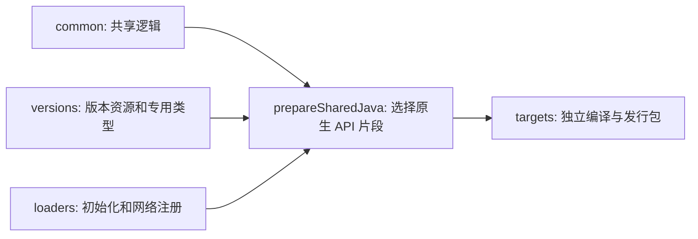

# Visual Creative Tab Editor / 可视化创造标签页编辑器

中文名：**可视化创造标签页编辑器**。这是一个用于可视化、数据驱动编辑 Minecraft 创造标签页的 Fabric、Forge 与 NeoForge 多加载器 Mod。

A Fabric, Forge and NeoForge mod for visual, data-driven editing of Minecraft creative mode tabs.

## 当前状态 / Current status

当前版本已经实现：

- 原版与 Mod 创造标签页的数据驱动目录。
- 最低优先级自动默认包与最高优先级玩家差异包。
- 统一的标签/物品可视化编辑模式。
- 多选拖动、删除、修改、新建、跨标签移动和自动翻页。
- 标签标题与图标编辑。
- 按语义类别、本地化名称、ID 和 Mod ID 整理。
- 服务端权限校验、修订冲突检测和保存回滚。
- 撤回上一步 / Ctrl+Z、恢复隐藏栏目、恢复默认排列。
- 跨存档模板和仅客户端多人服务器布局。
- 更大目录容量、基岩版风格按钮与无阴影文字。
- 楼梯、台阶、墙、栅栏等同类物品自动折叠，点击组图标展开或收起。

The current version includes the data-driven catalog, world-local priority packs,
the unified visual editor, semantic sorting, server validation, conflict handling,
and native Fabric/Forge/NeoForge pagination integration.

## 物品分组 / Item groups

同一标签页中的同类物品默认合并为一个代表图标。组头和展开后的成员使用基岩版风格的独立底色与边框，右下角显示“＋”或“－”。点击组图标展开全部成员，再次点击标记收起。

长按组图标进入原有编辑模式，可以修改名称和图标、拖动整组排序或移动到其他标签页，也可以解散分组并保留物品。选中至少两个物品后，长按物品并选择“合并选中物品”新建分组。将物品拖到组内可加入分组，拖到组外可移出；展开后的成员也可通过长按菜单移出。分组与布局一起保存，沿用取消、撤销、恢复和服务端权限校验。

编辑时点击右侧“物品组”按钮，可新建、编辑或删除物品组，也可将选中的物品移入目标组或移出分组。点击组头的展开标记可指定目标组，再选中要加入的物品。删除组只移除分组关系，保留成员物品；右上角复选标记表示整组是否已选中。

Similar items in each tab collapse into a representative icon. Group headers and expanded members have Bedrock-style cell backgrounds and borders, with lower-right expand/collapse markers. Long-press a group to rename it, change its icon, move it as a whole, or dissolve it without deleting its items. Select at least two items and choose “Group selected items” from the long-press menu to create a group. Drag items into or out of groups to change membership. Groups use the existing layout save, cancel, undo and server permission flow.

The Groups button opens controls to create, edit or delete a group and add or remove selected members. Click a group's expand marker to choose it as the target, then select the items to add. Deleting a group keeps its items. The upper-right checkbox shows whole-group selection.

手动分组优先于自动分组。移出组的物品会保持独立，直到再次手动加入分组。

Manual groups take precedence over automatic grouping. Removed members stay independent until added to a group again.

首次启动客户端会创建 `config/visual_creative_tab_editor/client.json`。将 `group_similar_items` 改为 `false` 后重启客户端，即可恢复平铺显示；已保存的分组数据仍然保留。

The client creates `config/visual_creative_tab_editor/client.json` on first launch. Set `group_similar_items` to `false` and restart the client to show the flat item list. Saved group definitions are retained.

```json
{
  "group_similar_items": true
}
```


## 支持版本 / Supported versions

当前 Mod 版本：`2.2.0`。

| Minecraft | Loader | Java |
| --- | --- | --- |
| `1.20.1` | Fabric、Forge | `17+` |
| `1.21.1` | Fabric、Forge、NeoForge | `21+` |
| `26.1.2` | Fabric、NeoForge | `25+` |
| `26.2` | Fabric、NeoForge | `25+` |

多人游戏可仅客户端安装并保存自己的布局；客户端与服务端安装相同版本时使用服务端权威共享布局和权限校验。Fabric 环境需要 Fabric API。

Client-only multiplayer keeps a local layout per server. Use the same mod version on both sides for server-authoritative shared layouts and permission checks. Fabric requires Fabric API.

## Wiki

完整安装、编辑器、数据包和开发文档：

Full installation, editor, data-pack, and development documentation:

[GitHub Wiki](https://github.com/kltyton/Visual-Creative-Tab-Editor/wiki)

Wiki 源文件同时保存在 [`wiki/`](wiki/Home.md)。

## 构建 / Build

```powershell
.\gradlew.bat listTargets
.\gradlew.bat build_neoforge_1_21_1
.\gradlew.bat buildAllTargets
.\gradlew.bat runClient_neoforge_1_21_1
```

构建产物：

```text
targets/fabric-26.2/build/libs/visual_creative_tab_editor-fabric-26.2-2.1.1.jar
targets/neoforge-26.2/build/libs/visual_creative_tab_editor-neoforge-26.2-2.1.1.jar
```

工程使用 [KltytonTemple](https://github.com/kltyton/KltytonTemple) 的独立目标入口。`select_<loader>_<version>` 设置根 `build`、`runClient` 的默认目标；`buildAllTargets` 构建全部九个目标。IDEA 将各目标独立关联，每个目标使用自己的 Wrapper 和 Java。

Minecraft 1.20.1 使用 Java 17，1.21.1 使用 Java 21，26.1.2／26.2 使用 Java 25。Fabric 支持这四个版本；Forge 支持 1.20.1／1.21.1；NeoForge 支持 1.21.1／26.1.2／26.2。



手写源码维护在 `common`、`versions` 和 `loaders`；`// @target` 标记只选择实际存在的版本或加载器差异。共享源码经 `prepareSharedJava` 写入目标的 `build/generated/sources/shared`，编译和源码包任务依赖这个生产者。26.x 的原生类型改名在该步骤完成，生成结果不手改。手写资源仍由原来的 JSON、AT、AW／ClassTweaker 和 Mixin 配置维护。

## License

LGPL-3.0-or-later
