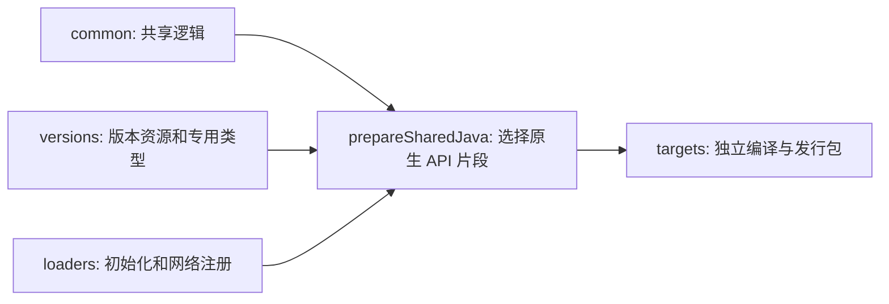

# Visual Creative Tab Editor / 可视化创造标签页编辑器

中文名：**可视化创造标签页编辑器**。这是一个用于可视化、数据驱动编辑 Minecraft 创造标签页的 Fabric 与 NeoForge 多加载器 Mod。

A Fabric and NeoForge mod for visual, data-driven editing of Minecraft creative mode tabs.

## 当前状态 / Current status

当前版本已经实现：

- 原版与 Mod 创造标签页的数据驱动目录。
- 最低优先级自动默认包与最高优先级玩家差异包。
- 统一的标签/物品可视化编辑模式。
- 多选拖动、删除、修改、新建、跨标签移动和自动翻页。
- 标签标题与图标编辑。
- 按语义类别、本地化名称、ID 和 Mod ID 整理。
- 服务端权限校验、修订冲突检测和保存回滚。
- 撤回上一步 / Ctrl+Z、恢复隐藏栏目、恢复默认排列。
- 跨存档模板和仅客户端多人服务器布局。
- 更大目录容量、基岩版风格按钮与无阴影文字。

The current version includes the data-driven catalog, world-local priority packs,
the unified visual editor, semantic sorting, server validation, conflict handling,
and native Fabric/NeoForge pagination integration.

## 支持版本 / Supported versions

| 项目 / Component | 版本 / Version |
| --- | --- |
| Mod | `2.1.0` |
| Minecraft | `26.2` |
| Java | `25+` |
| Fabric | Loader `0.19.3+` + Fabric API；tested with `0.152.1+26.2` |
| NeoForge | `26.2.0.1-beta+` |

多人游戏可仅客户端安装并保存自己的布局；服务端也安装时使用服务端权威共享布局和权限校验。Fabric 环境需要 Fabric API。

Client-only multiplayer keeps a local layout per server. Install on both sides for server-authoritative shared layouts and permission checks. Fabric requires Fabric API.

## Wiki

完整安装、编辑器、数据包和开发文档：

Full installation, editor, data-pack, and development documentation:

[GitHub Wiki](https://github.com/kltyton/Visual-Creative-Tab-Editor/wiki)

Wiki 源文件同时保存在 [`wiki/`](wiki/Home.md)。

## 构建 / Build

```powershell
.\gradlew.bat listTargets
.\gradlew.bat build_neoforge_1_21_1
.\gradlew.bat buildAllTargets
.\gradlew.bat runClient_neoforge_1_21_1
```

构建产物：

```text
targets/fabric-26.2/build/libs/visual_creative_tab_editor-fabric-26.2-2.1.1.jar
targets/neoforge-26.2/build/libs/visual_creative_tab_editor-neoforge-26.2-2.1.1.jar
```

工程使用 [KltytonTemple](https://github.com/kltyton/KltytonTemple) 的独立目标入口。`select_<loader>_<version>` 设置根 `build`、`runClient` 的默认目标；`buildAllTargets` 构建全部九个目标。IDEA 将各目标独立关联，每个目标使用自己的 Wrapper 和 Java。

Minecraft 1.20.1 使用 Java 17，1.21.1 使用 Java 21，26.1.2／26.2 使用 Java 25。Fabric 支持这四个版本；Forge 支持 1.20.1／1.21.1；NeoForge 支持 1.21.1／26.1.2／26.2。



手写源码维护在 `common`、`versions` 和 `loaders`；`// @target` 标记只选择实际存在的版本或加载器差异。共享源码经 `prepareSharedJava` 写入目标的 `build/generated/sources/shared`，编译和源码包任务依赖这个生产者。26.x 的原生类型改名在该步骤完成，生成结果不手改。手写资源仍由原来的 JSON、AT、AW／ClassTweaker 和 Mixin 配置维护。

## License

LGPL-3.0-or-later
