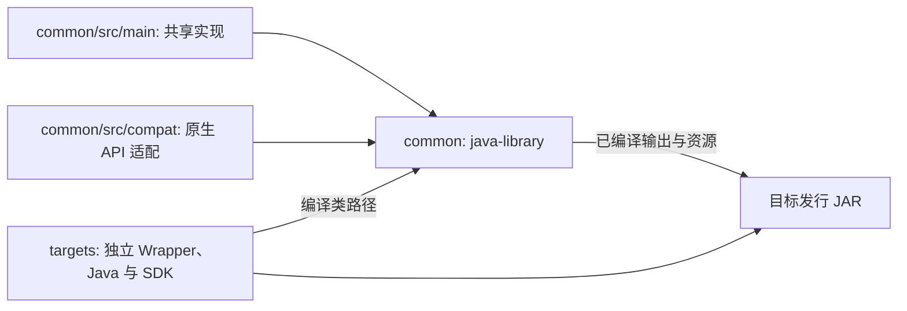

# Visual Creative Tab Editor / 可视化创造标签页编辑器

中文名：**可视化创造标签页编辑器**。这是一个用于可视化、数据驱动编辑 Minecraft 创造标签页的 Fabric、Forge 与 NeoForge 多加载器 Mod。

A Fabric, Forge and NeoForge mod for visual, data-driven editing of Minecraft creative mode tabs.

## 当前状态 / Current status

当前版本已经实现：

- 原版与 Mod 创造标签页的数据驱动目录。
- 最低优先级自动默认包与最高优先级玩家差异包。
- 统一的标签/物品可视化编辑模式。
- 多选拖动、删除、修改、新建、跨标签移动和自动翻页。
- 标签标题与图标编辑。
- 按语义类别、本地化名称、ID 和 Mod ID 整理。
- 服务端权限校验、修订冲突检测和保存回滚。
- 撤回上一步 / Ctrl+Z、恢复隐藏栏目、恢复默认排列。
- 跨存档模板和仅客户端多人服务器布局。
- 更大目录容量、基岩版风格按钮与无阴影文字。
- 楼梯、台阶、墙、栅栏等同类物品自动折叠，点击组图标展开或收起。

The current version includes the data-driven catalog, world-local priority packs,
the unified visual editor, semantic sorting, server validation, conflict handling,
and native Fabric/Forge/NeoForge pagination integration.

## 物品分组 / Item groups

同一标签页中的同类物品默认合并为一个代表图标。组头和展开后的成员使用基岩版风格的独立底色与边框，普通浏览时右上角显示“＋”或“－”；编辑时标记移至右下角，避让选择框。点击组图标展开全部成员，再次点击标记收起。

长按组图标进入原有编辑模式，可以修改名称和图标、拖动整组排序或移动到其他标签页，也可以解散分组并保留物品。选中至少两个物品后，长按物品并选择“合并选中物品”新建分组。将物品拖到组内可加入分组，拖到组外可移出；展开后的成员也可通过长按菜单移出。分组与布局一起保存，沿用取消、撤销、恢复和服务端权限校验。

编辑时点击右侧“物品组”按钮，可新建、编辑或删除物品组，也可将选中的物品移入目标组或移出分组。点击组头的展开标记可指定目标组，再选中要加入的物品。删除组只移除分组关系，保留成员物品；右上角复选标记表示整组是否已选中。

Similar items in each tab collapse into a representative icon. Group headers and expanded members have Bedrock-style cell backgrounds and borders. Expand/collapse markers appear at the upper right while browsing and at the lower right while editing, leaving room for selection checkboxes. Long-press a group to rename it, change its icon, move it as a whole, or dissolve it without deleting its items. Select at least two items and choose “Group selected items” from the long-press menu to create a group. Drag items into or out of groups to change membership. Groups use the existing layout save, cancel, undo and server permission flow.

The Groups button opens controls to create, edit or delete a group and add or remove selected members. Click a group's expand marker to choose it as the target, then select the items to add. Deleting a group keeps its items. The upper-right checkbox shows whole-group selection.

手动分组优先于自动分组。移出组的物品会保持独立，直到再次手动加入分组。

Manual groups take precedence over automatic grouping. Removed members stay independent until added to a group again.

首次启动客户端会创建 `config/visual_creative_tab_editor/client.json`。在编辑界面点击右侧“关闭全部折叠”，会立即将所有物品组恢复为平铺显示，并将 `group_similar_items` 保存为 `false`，不需要重启。已保存的分组数据仍然保留，可用“开启物品折叠”重新启用。也可以直接修改配置文件后重启客户端。

The client creates `config/visual_creative_tab_editor/client.json` on first launch. Click **Unfold all** in the editor to immediately show a flat item list and save `group_similar_items: false`. **Fold items** enables grouping again. Saved group definitions are retained. Editing the file directly takes effect after restarting the client.

```json
{
  "group_similar_items": true
}
```

## 标签内分类 / Categories within a tab

分类显示为贴在创造物品栏左侧的图标子标签，点击即可切换当前标签页中的物品。按住 Shift 点击可同时显示多个分类；罗盘图标显示全部，纸张图标显示未分类物品。上下箭头与侧栏上的滚轮用于翻页，顶部箭头可收起或展开侧栏，当前筛选会保留。

编辑普通创造标签页时，左侧侧栏的“+”可直接新建分类并打开名称和图标编辑。选中自定义分类后，可用右侧“编辑分类”和“删除分类”直接操作；“全部”和“未分类”是固定筛选入口，不能删除。右侧“分类”面板还可调整顺序、加入或移出所选物品。删除分类保留所有物品。分类与布局一起保存，支持取消和撤销；一个物品可以属于多个分类。分类筛选与物品折叠独立，并与其他模组提供的当前物品列表取交集。

Use the icon sub-tabs attached to the left of the creative inventory to switch categories, or Shift-click to select several. The compass shows all items and the paper shows uncategorized items. Page with the arrows or the wheel over the sidebar; collapsing it keeps the current filter. While editing, its **+** creates a category. Select a custom category to use **Edit category** or **Delete category** on the right; the all-items and uncategorized filters cannot be deleted. **Categories** opens the order and membership controls. Deleting a category keeps its items. Categories use the layout's save, cancel and undo flow, independently of item folding.

分类选择方式参考 [MrCrayfish's Furniture Mod: Refurbished](https://github.com/MrCrayfish/MrCrayfishFurnitureMod-Refurbished)。

左侧分类标签使用原版贴图，其余编辑控件与展开按钮采用 Ore 样式。共装模组的左侧筛选栏保留原有位置、点击与滚轮区域，分类标签通过连续边框连接到物品栏。

The category sidebar uses vanilla tab and button textures. Existing left-side mod filters remain available, with custom categories placed outside their controls. Each sidebar retains its own click and wheel area.

## 抽屉 / Drawers

栏目抽屉和物品抽屉默认收起，仅保留物品栏右边缘的微型箭头。点击后显示书本和箱子图标，分别打开栏目与物品抽屉。关闭面板或重新打开创造物品栏时恢复收起；已有来源筛选和文件夹偏好会保留。

Tab and item drawers start collapsed behind a small arrow on the inventory's right edge. It reveals book and chest icons for the two drawers. Closing a panel or reopening the inventory folds them away. Source filters and folder preferences are retained.

编辑界面使用原生绘制的 Ore 风格面板、按钮与勾选框，颜色和边框参考 [mcui-oreui](https://github.com/ShenYuanOR/mcui-oreui)。


## 支持版本 / Supported versions

当前 Mod 版本：`2.3.1`。

| Minecraft | Loader | Java |
| --- | --- | --- |
| `1.20.1` | Fabric、Forge | `17+` |
| `1.21.1` | Fabric、Forge、NeoForge | `21+` |
| `26.1.2` | Fabric、NeoForge | `25+` |
| `26.2` | Fabric、NeoForge | `25+` |

多人游戏可仅客户端安装并保存自己的布局；客户端与服务端安装相同版本时使用服务端权威共享布局和权限校验。Fabric 环境需要 Fabric API。

Client-only multiplayer keeps a local layout per server. Use the same mod version on both sides for server-authoritative shared layouts and permission checks. Fabric requires Fabric API.

## Wiki

完整安装、编辑器、数据包和开发文档：

Full installation, editor, data-pack, and development documentation:

[GitHub Wiki](https://github.com/kltyton/Visual-Creative-Tab-Editor/wiki)

Wiki 源文件同时保存在 [`wiki/`](wiki/Home.md)。

## 构建 / Build

```powershell
.\gradlew.bat listTargets
.\gradlew.bat build_neoforge_1_21_1
.\gradlew.bat buildAllTargets
.\gradlew.bat runClient_neoforge_1_21_1
```

构建产物：

```text
targets/fabric-26.2/build/libs/visual_creative_tab_editor-fabric-26.2-2.3.1.jar
targets/neoforge-26.2/build/libs/visual_creative_tab_editor-neoforge-26.2-2.3.1.jar
```

工程使用 [KltytonTemple](https://github.com/kltyton/KltytonTemple) 的独立目标入口。`select_<loader>_<version>` 设置根 `build`、`runClient` 的默认目标；`buildAllTargets` 构建全部九个目标。IDEA 将各目标独立关联，每个目标使用自己的 Wrapper 和 Java。

Minecraft 1.20.1 使用 Java 17，1.21.1 使用 Java 21，26.1.2／26.2 使用 Java 25。Fabric 支持这四个版本；Forge 支持 1.20.1／1.21.1；NeoForge 支持 1.21.1／26.1.2／26.2。



生产 Java 统一维护在 `common`。通用算法、编辑状态和数据规则位于 `common/src/main`；Minecraft API 族、具体版本及 Loader 的类型、事件和生命周期差异位于 `common/src/compat`。源码使用普通 Java，通过源集合选择对应适配层。手写 JSON、贴图、AT、AW／ClassTweaker 和 Mixin 配置继续按原方式维护。

当前编辑目标的 `:common` 使用物理 `common/` 目录，共享 Java 与资源只有一个 IDEA 所有者。其余目标使用各自的构建上下文与编译输出；切换目标后重新加载 Gradle 模型，以更新 `common` 的 SDK 和补全环境。每个目标的发行包合入 `common` 的编译输出，目标目录负责构建、元数据与运行目录。

## License

LGPL-3.0-or-later
