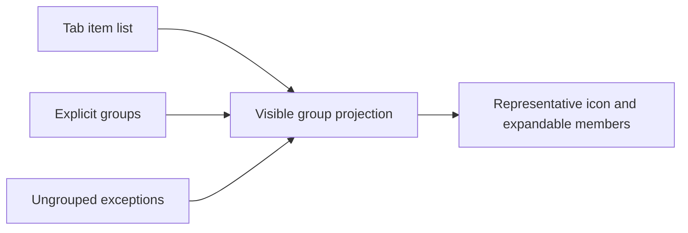
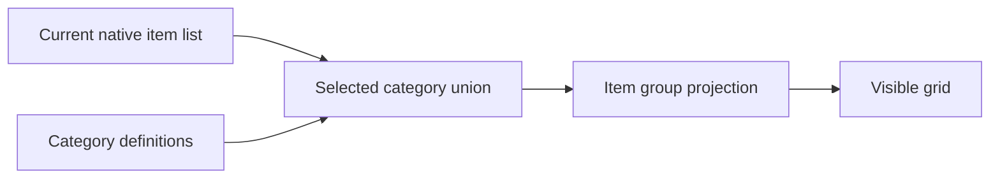

# Creative Tab data pack format

Visual Creative Tab Editor reads server-data resources from:

```text
data/<namespace>/creative_tabs/<path>.json
```

The resource path is also the tab identifier. For example,
`data/example/creative_tabs/building/favorites.json` defines
`example:building/favorites`.

## Layering

Fields are merged independently in the real selected-pack order, from lowest to
highest priority. A higher pack can therefore change only an icon or title while
retaining the lower layer's items.

Each world contains two reserved directory packs:

- `visual_creative_tab_editor_generated_default` is regenerated from the final
  native and modded tabs and pinned below every other pack.
- `visual_creative_tab_editor_player_overrides` stores visual-editor differences
  and is pinned above every other pack.

The player pack stores field-level differences from the non-player result. New
tabs added by a later mod therefore continue to appear.

## Schema version 1

All fields other than `format` are optional in an overriding resource. A new tab
should provide a title, icon, and item list.

Setting `hidden` also removes that tab's `search_items` contribution from the
rebuilt global Search tab while preserving the tab identity.

```json
{
  "format": 1,
  "title": { "text": "Favorites" },
  "icon": { "id": "minecraft:diamond", "count": 1 },
  "items": [
    { "id": "minecraft:diamond", "count": 1 },
    { "id": "minecraft:enchanted_golden_apple", "count": 1 }
  ],
  "search_items": [
    { "id": "minecraft:diamond", "count": 1 },
    { "id": "minecraft:enchanted_golden_apple", "count": 1 }
  ],
  "hidden": false,
  "order": 20,
  "type": "category",
  "can_scroll": true,
  "show_title": true,
  "aligned_right": false,
  "background": "minecraft:textures/gui/container/creative_inventory/tab_items.png"
}
```

`title` uses Minecraft's component JSON. `icon`, `items`, and `search_items` use the
Minecraft 26.2 `ItemStack` codec, so data components are preserved. Stack counts
must be exactly one. A category-tab `items` entry can also be `null` to reserve
an empty display slot, such as a cell used by a native section banner. These
slots retain their order through saving and synchronization and are excluded
from item groups and search. For category tabs, `items` is the visible parent-tab list and
`search_items` is its independent contribution to global search; this preserves
Minecraft's parent-only and search-only entries.

Layers merge field by field from low to high priority. A missing field inherits
the lower value; a present field replaces it as a whole. Arrays are not appended,
an empty array clears a list. A field cannot be `null`; the only nullable list
entries are empty display slots inside a category-tab `items` array.

Supported `type` values are:

- `category`
- `search`
- `hotbar`
- `inventory`

Only `category` may be introduced as a new runtime tab. Existing special tabs
retain their native behavior. In particular, `minecraft:hotbar`,
`minecraft:search`, and `minecraft:inventory` must retain their respective
`hotbar`, `search`, and `inventory` types. A search-tab `items` list is interpreted as a
preferred ordering: items not listed there, including items from newly installed
mods, are appended automatically.

## Item groups

The optional `item_groups` field stores group definitions and exceptions to automatic grouping. It is supported by category and search tabs. Omitting the field preserves the lower-priority value; `{ "groups": [], "ungrouped": [] }` restores automatic grouping for the tab.

```json
{
  "item_groups": {
    "groups": [
      {
        "id": "custom/wooden_stairs",
        "title": { "text": "Wooden stairs" },
        "icon": { "id": "minecraft:oak_stairs", "count": 1 },
        "items": [
          { "id": "minecraft:oak_stairs", "count": 1 },
          { "id": "minecraft:birch_stairs", "count": 1 }
        ]
      }
    ],
    "ungrouped": [
      { "id": "minecraft:stone_stairs", "count": 1 }
    ]
  }
}
```

| Field | Meaning |
| --- | --- |
| `groups[].id` | Stable identifier within the tab. The editor creates `custom/<uuid>` identifiers. |
| `groups[].title` | Minecraft text component used as the group name. |
| `groups[].icon` | Count-one icon stack; it need not be a member of the group. |
| `groups[].items` | Member identities, including NBT or data components. At least one member is required. |
| `ungrouped` | Items explicitly excluded from automatic grouping. |

Explicit membership takes precedence over automatic classification. An item may appear in only one explicit group or in `ungrouped`. Group membership does not add items to the tab: only members present in the current tab view are displayed. Group definitions survive search filtering, and dissolving a group keeps its items.

Automatic block groups use `block/<family>` identifiers, such as `block/stairs`. Item variants use `item/<namespace>:<path>`. These identifiers let name or icon overrides retain automatic collection of new matching items. Moving a complete group to another tab preserves it as a custom group.



The client option `config/visual_creative_tab_editor/client.json` controls whether groups are displayed. The editor's **Unfold all** button writes `group_similar_items: false` and immediately shows a flat list without deleting group definitions. **Fold items** enables grouping again. Client and server must use matching editing protocols for shared layout editing.

## Categories within a tab

The optional `categories` array defines named filters within a `category` tab. It is independent of `item_groups`. Omitting it inherits the lower-priority value; an empty array removes the categories. Each entry requires `id`, `title`, `icon` and `items`:

```json
{
  "categories": [
    {
      "id": "custom/building",
      "title": { "text": "Building" },
      "icon": { "id": "minecraft:bricks", "count": 1 },
      "items": [
        { "id": "minecraft:bricks", "count": 1 },
        { "id": "minecraft:brick_stairs", "count": 1 }
      ]
    }
  ]
}
```

Category identifiers must be unique within their parent tab. A category may be empty, and an item may belong to several categories. Members use complete NBT/component identities and do not add items to the parent tab or global search. Filters intersect the current native item list, preserving filters supplied by other mods. The category order follows the array order. Browsing selections are local to the open creative screen; category definitions use the normal layout save, cancel and undo flow.



Category documents keep format `1`, so existing documents without the field retain their original meaning. Category-aware network payloads use protocol `4` and separate optional channels; older protocol peers are not sent documents they cannot decode.

## Limits and failure behavior

- 512 tabs per resolved catalog.
- 262144 stacks in `items` and 262144 stacks in `search_items` per tab, with 2097152
  configured stacks total across the catalog.
- Group members and ungrouped exceptions have a separate combined limit of 262144 references per tab and 2097152 across the catalog.
- Each category tab supports up to 512 categories and 262144 category member references. Category and item-group references share the catalog-wide reference limit.
- Unknown fields, invalid identifiers, empty stacks, invalid components, and
  unsupported schema versions fail the resource reload.
- Stale entries in the two reserved, Mod-owned world packs are skipped instead
  of preventing world startup (for example after a Mod is removed). The default
  pack is regenerated at server start; third-party packs remain strictly
  validated.
- A resolved catalog must retain at least one visible category tab.
- The combined base-and-resolved network snapshot must fit within 128 MiB
  expanded and 16 MiB compressed; an oversized resource reload is rejected.

On reload failure Minecraft retains the previous valid resource state. The
visual editor additionally uses a revision number so two administrators cannot
silently overwrite one another.
