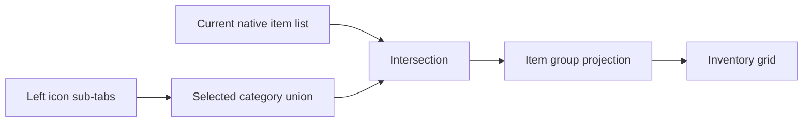

# Visual editor

The server grants editing to players with the vanilla game-master command
permission. All changes are validated and saved by the logical server.

## Subcategories within a creative tab

The icon tabs attached to the inventory's left edge select subcategories inside
the current creative tab. Shift-click combines categories; the compass restores
all items and the paper selects uncategorized items. The arrows and mouse wheel
page the sidebar, and its top control collapses it without clearing the filter.

Category tabs use vanilla left-tab textures; navigation and editing controls use
Ore styling. Native mod filters keep their positions and input regions. A joined
frame connects the outer category tabs to the inventory, and selected categories
intersect the native filter result.

While editing, the sidebar's `+` creates a category and opens its name/icon
editor. **Categories** provides membership, order and deletion controls. Category
definitions use the normal Save, Cancel and Undo flow. Deleting a category keeps
the parent tab's items.

## Entering edit mode

Tab and item drawers start collapsed behind a small Ore arrow on the inventory's
right edge. It reveals book and chest icon buttons. Closing a drawer or reopening
the inventory hides those buttons. Folder expansion and source filters are retained.

- Hold a tab icon for 500 ms to open its Modify/Delete menu.
- Hold an item in a category tab for 500 ms to open its Modify/Delete menu.
- Hold an item in the Search tab for 500 ms to enter edit mode; search items
  support selection and same-tab ordering, but not Modify/Delete.
- Hold any non-interactive empty part of the creative-inventory frame or tab
  strip for 500 ms to enter edit mode.

In edit mode, click checkboxes to select one or more icons. Drag any selected
icon to move the selected block; surrounding icons make room. Drop onto the red
Delete area, or click the red Delete button, to remove the selection. There is
no keyboard Delete shortcut. Removing a tab stores `hidden: true`; it does not
mutate Minecraft's frozen registry.

Search-tab items can be reordered by the same drag gesture, including while the
search box is filtering the view. Visible stacks are matched back to the full
working order by item and components. The persisted preferred-order prefix is
bounded by both the per-tab 16384-item limit and the catalog-wide 65536-item
limit; attempts outside that writable prefix are rejected with a diagnostic log
instead of corrupting the order.

Holding a dragged icon at the left or right edge for 500 ms turns the native
creative-tab page. Dragging an item over another category tab for 450 ms opens
that tab and moves the selected items into it.

The editor also accepts Page Up and Page Down. Tab selections and item
selections share one draft but remain separate drag groups; switching the
current tab clears index-based item selection.

The faint tab-shaped `+` on the last tab page creates an empty category whose
default title and icon come from the selected inventory stack. The item `+`
is a virtual tail slot after the last item and remains reachable through the
normal scrollbar even when the category contains exactly 45, 90, or another
full-page item count. Item and icon selection temporarily shows the full
survival inventory. The tab Modify dialog edits its title and icon. Titles are
limited to 128 characters. An unchanged translated title remains translated;
only text actually edited by the player becomes a literal custom title. Item
and icon pickers accept only non-empty slots from the player's inventory. Equal
item-and-component stacks are moved or merged instead of duplicated.

Save writes the highest-priority world pack. Cancel discards the draft. Clicking
non-icon empty space saves and exits, matching a phone home-screen editor.
The screen waits for the server acknowledgement before closing. Another save or
any successful reload advances the server revision, even when the resolved data
is unchanged. The old draft is never silently rebased; a conflict prompt asks
the player to close it and reopen the editor on the latest revision.

## Organize

The Organize menu sorts the current category or Search tab by:

- semantic creative-menu group and the group's native item order;
- registry ID path;
- localized displayed item name;
- full `namespace:path` ID.

Displayed-name sorting uses the current Minecraft language. The Search tab also
offers Mod ID sorting, using the namespace before the colon. Search sorting is a
preferred order: newly added items not present in the saved preference are still
appended automatically.
