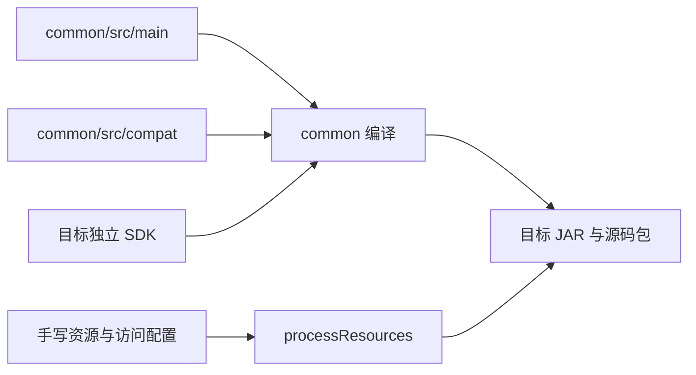

# 开发与构建

## 环境

| 项目 | 值 |
| --- | --- |
| JDK | Java `25` |
| Gradle Wrapper | 仓库自带 |
| Minecraft | `26.2` |
| Fabric Loader | `0.19.3` |
| Fabric API | `0.152.1+26.2` |
| NeoForge | `26.2.0.1-beta` |

## 模块

- `common/src/main`：共享数据模型、JSON 文档、服务器状态、网络协议、运行时目录和编辑器算法。
- `common/src/compat`：Minecraft API 族、具体版本和 Loader 的原生类型、渲染、输入、注册及生命周期适配；手写访问配置与对应资源随其版本维护。
- `common/build.gradle`：真实 Java Library 模块，使用各目标自己的 Minecraft／Loader SDK，按目标隔离输出。
- `targets/<loader>-<minecraft>`：独立 Wrapper、Java、构建入口、加载器元数据和运行目录。
- `buildSrc` 与 `integrations/shared`：KltytonTemple 的目标管理、表单和版本目录。
- `gradle/target-conventions`：源码选择、资源扩展、发行包与发布约定。
- `wiki`：可直接同步到 GitHub Wiki 独立仓库的 Markdown 源文件。

## 常用命令

Windows PowerShell：

```powershell
.\gradlew.bat listTargets
.\gradlew.bat build_neoforge_1_21_1
.\gradlew.bat buildAllTargets
.\gradlew.bat runClient_neoforge_1_21_1
```

最终 JAR：

```text
targets/fabric-26.2/build/libs/visual_creative_tab_editor-fabric-26.2-2.3.1.jar
targets/neoforge-26.2/build/libs/visual_creative_tab_editor-neoforge-26.2-2.3.1.jar
```

## 验证要求

根任务通过各目标自己的 Wrapper 执行。1.20.1 使用 Java 17，1.21.1 使用 Java 21，26.1.2／26.2 使用 Java 25。`select_<loader>_<version>` 同时选择根任务与 `common` 的编辑 SDK；重新加载 Gradle 模型后生效。IDEA 仍关联全部九个独立目标，共享 Java 和资源根只由活动目标的物理 `common` 模块拥有。



源码通过普通 Java 的 API 绑定与 Gradle 源集合选择维护。共享算法保留一份，编译输出进入 `common/build/<loader>-<minecraft>`。资源由目标与 `common` 按既定优先级处理；发行包合入 `common` 输出，开发运行也将它加入同一模组分组。NeoForge 1.21.1 输入框使用公开的 `setTextShadow(false)`；Fabric／Forge 旧版渲染保留对应 Mixin 和 refmap。

只看到主菜单不代表创造标签功能已经验证。涉及运行时 UI 或分页的修改至少应覆盖：

1. `build` 成功。
2. Fabric 与 NeoForge 能完成资源、音频和纹理加载。
3. 实际进入创造模式世界。
4. 首次按 `E` 打开创造物品栏。
5. 至少执行一次编辑器相关操作。
6. 涉及资源目录时执行 `/reload` 后再次打开创造栏。
7. 检查 `latest.log`、新崩溃报告和 `[EditorTrace]`。

涉及分页时还应测试第 `11` 个普通标签、跨页拖动、左右边缘自动翻页、搜索标签和生存物品栏标签。

## 访问性变更

新增私有成员访问需求时按以下顺序选择：

1. 公共 API。
2. Fabric ClassTweaker / NeoForge Access Transformer。
3. 只有行为注入才使用 Mixin。

不要为纯字段或方法访问新增 Mixin Accessor/Invoker。

## 数据和协议限制

修改 schema、目录限制或网络负载时，必须同步更新：

- `CreativeTabJsonCodec`
- `CreativeTabValidation`
- `PayloadChunks`
- 客户端与服务端 payload 注册
- [数据包格式](https://github.com/kltyton/Visual-Creative-Tab-Editor/wiki/数据包格式)
- [架构设计](https://github.com/kltyton/Visual-Creative-Tab-Editor/wiki/架构设计)

## Wiki 发布

GitHub Wiki 是独立 Git 仓库。首个页面创建后，将 `wiki/` 中的文件同步到：

```text
https://github.com/kltyton/Visual-Creative-Tab-Editor.wiki.git
```

`Home.md` 是入口，`_Sidebar.md` 和 `_Footer.md` 会由 GitHub 自动渲染为导航和页脚。只有推送到 Wiki 默认分支的提交会对读者生效。
